<p align="center">
  
</p>

<p align="center">
  
  
  
  
  
</p>

<p align="center"><b>A Fabric mod that stops the Nether being empty.</b><br>
Five peoples live there now, each in villages of its own, and none of them at peace with the others.<br>
Every one of them has a name, a job, a story, and a long memory for how you treat them.</p>

<p align="center">
  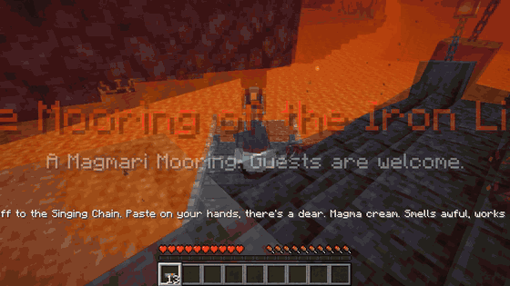
  <br><sub><i>Out on the lava sea, aboard a Magmari strider barge.</i></sub>
</p>

---

## The five peoples

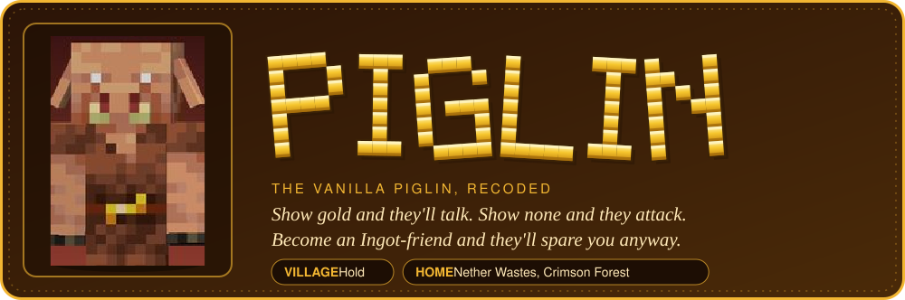

The Piglins you know, on their unchanged vanilla model, with new rules. Wear gold (golden armour, or any armour
with a gold trim) and they'll talk, barter and stay out of their kin's fights. Come without and they attack, as
ever. Their Brutes respect gold too, except inside a Bastion's treasure vault. Win a Piglin over to
**Ingot-friend** and that Piglin leaves you be even with your gold off.


The Wither's own people: your height, ash-dark, with the Wither's own head. Each one swore to remember one dead
person's name and carries it with theirs ("Sereth, who keeps Anwen"), and that name is cut into the Name Wall of
their Vigil. Neutral to you, but strike one and every Withren nearby answers. Summon a Wither and they turn cold.


Hunched, crested lava-waders with magma for skin and seams that glow while they're warm. Away from lava they cool
like striders, going ash-violet and grumpy. They're chainwrights, hagglers and hosts, and peaceful to you: hurt
one and they wade out where you can't follow. A Mooring's **Ferrier** will take you across the lava sea to another
Mooring on a strider barge, for a few warped fungus.

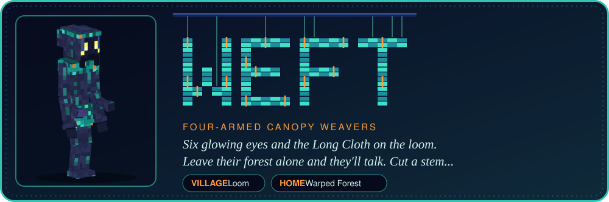

Slender four-armed weavers of the Warped Forest: a long pair of arms to climb, a short pair to weave. Six small
glowing eyes, bark skin of indigo and teal, and the Long Cloth hanging down through every Great Loom. They'll talk
to anyone who leaves their forest alone. Break warped stems near a Loom and the nets come down.


Pale, floating mourners of the Basalt Deltas, the ghasts' gentle kin. They cry once, properly, for each death and
then let it go, taking a new name each time ("Siel, who was Oriel"). Shy: come up quietly, sneaking, or they drift
up out of reach. They never fight.

<details>
<summary><b>Five peoples, no peace</b> &nbsp;(who has a grudge against whom)</summary>
<br>

Piglins attack anyone who shows no gold, and none of the other four ever wears it. On top of that, every pair has
its own grudge:

| | Withren | Magmari | Weft | Ghastkin |
|---|---|---|---|---|
| **Piglins** | The War of the Hoard and the Wither. | Gold melts on Magmari skin; Piglins raid their striders. | Piglins raid the canopy for shroomlights; Weft drop nets. | Piglins shoot them down as ghast whelps. |
| **Withren** | | The ferries that carried the Piglins; the Moorings the Wither burned. | Weft take bone from the Withren dead for needles and loom weights. | Withren keep every name; Ghastkin cry names away. |
| **Magmari** | | | Magmari raid the forest for warped fungus to drive striders. | A Ghastkin tear puts out a Magmari's glow. |
| **Weft** | | | | Weft string nets in the air to catch Ghastkin for their tears. |

Villages of different peoples never overlap.
</details>

## Their villages

<table>
  <tr>
    <td width="50%">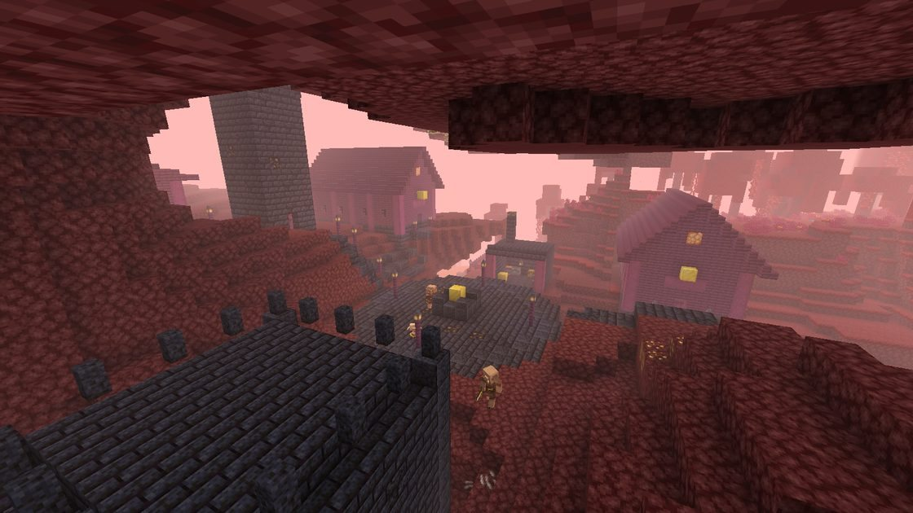<br><sub><b>Hold</b> (Piglins): the Hoard's battlements, a barter ring round a gold block, longhouses, the forge and the horn tower.</sub></td>
    <td width="50%">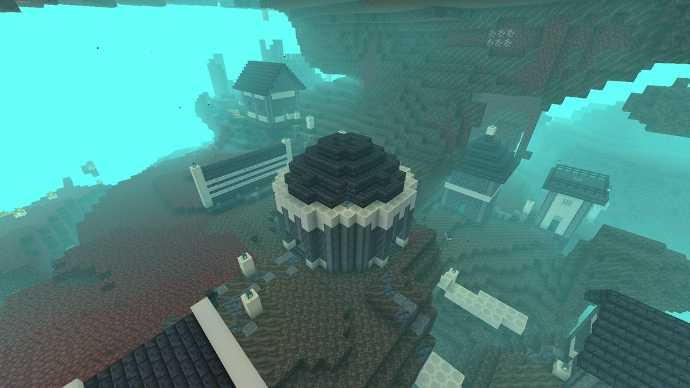<br><sub><b>Vigil</b> (Withren): the Hall of the Three, the Name Wall, homes, the Remembrancer's tower and an Ashwarden post.</sub></td>
  </tr>
  <tr>
    <td width="50%">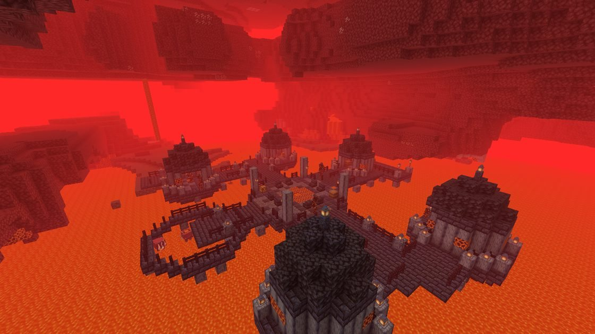<br><sub><b>Mooring</b> (Magmari): domed huts on basalt pillars round the hearth, out on the open lava sea, with a strider pen.</sub></td>
    <td width="50%">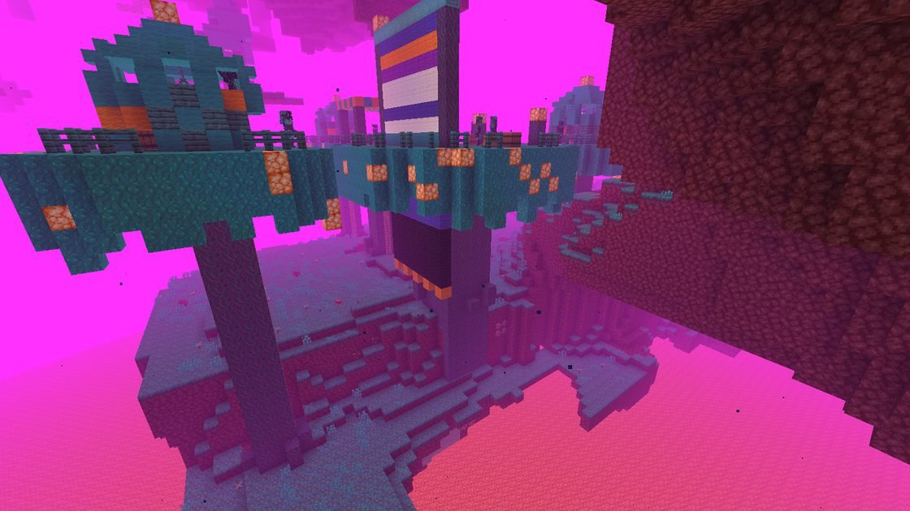<br><sub><b>Loom</b> (Weft): decks on fungus caps, woven huts, a dye house, and the Long Cloth through the Great Loom.</sub></td>
  </tr>
  <tr>
    <td width="50%">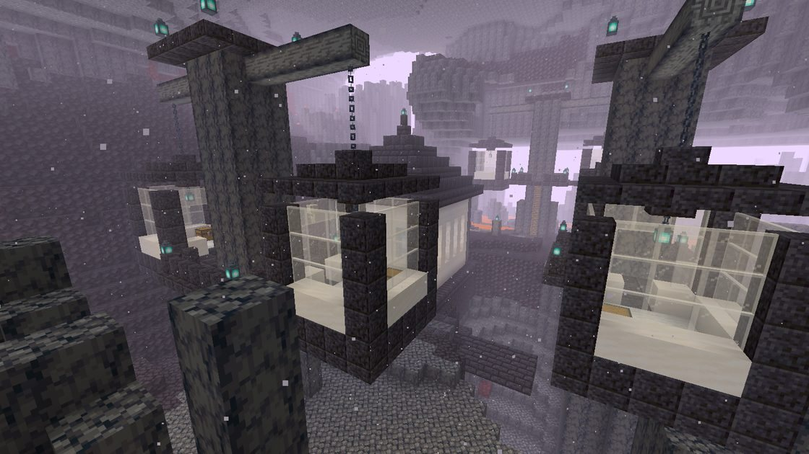<br><sub><b>Eave</b> (Ghastkin): lantern pods hung from basalt pillars, with the Weeping Hall behind.</sub></td>
    <td width="50%">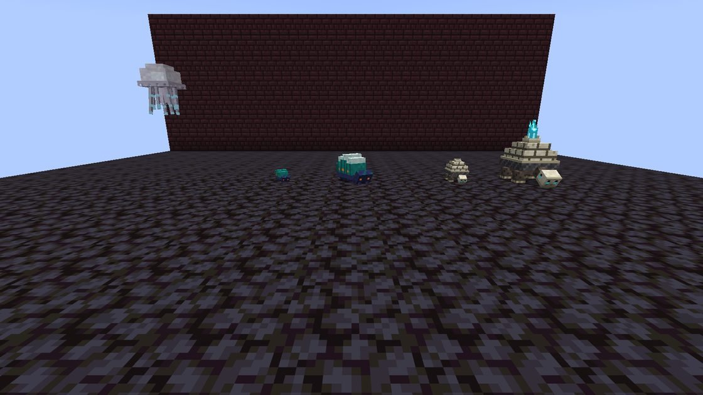<br><sub>An Ashbell drifting, then young and grown Silkgrubs and Cairnbacks. The young have no silk and no fire yet.</sub></td>
  </tr>
</table>

## Talking with them

Right-click anyone to talk. The conversation window (Village Friends' layout, recoloured netherrack) shows their
portrait, their line typing out in their own voice, numbered replies and your friendship.

<table>
  <tr>
    <td width="50%">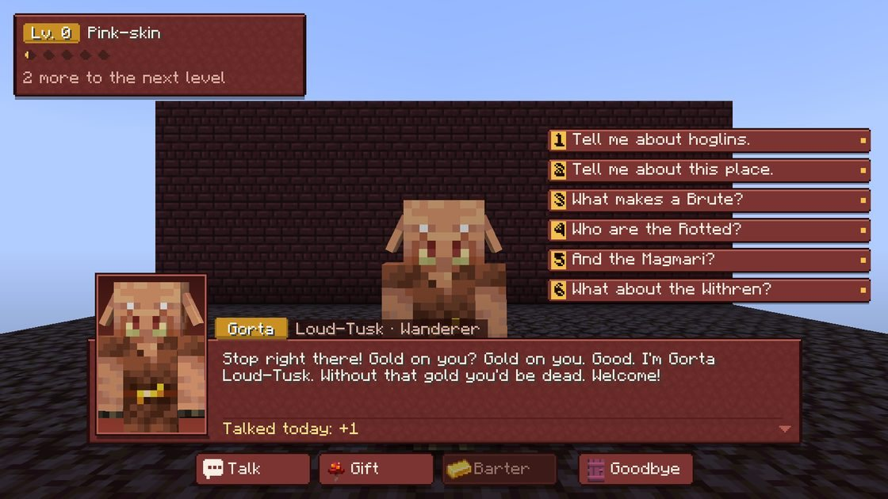<br><sub>Gorta Loud-Tusk only talks because you wear gold.</sub></td>
    <td width="50%">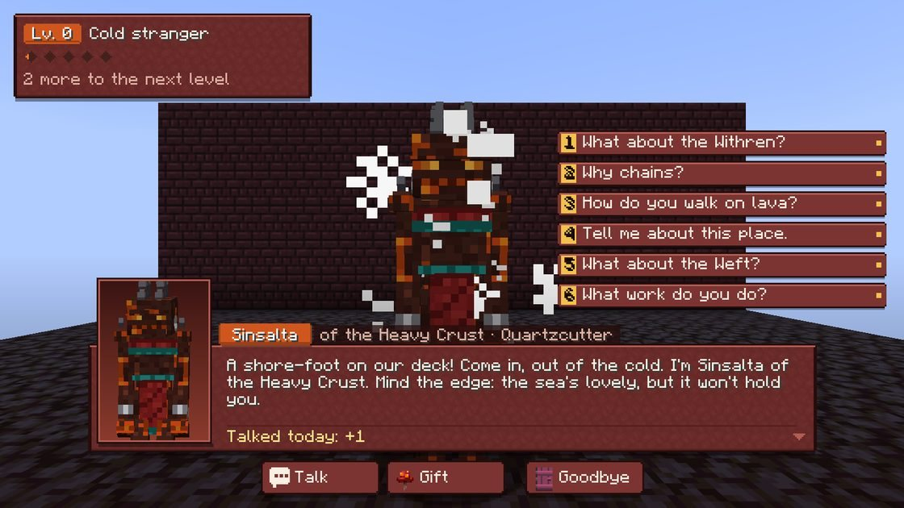<br><sub>Sinsalta of the Heavy Crust welcomes a shore-foot. Magmari count friendship in embers.</sub></td>
  </tr>
  <tr>
    <td width="50%">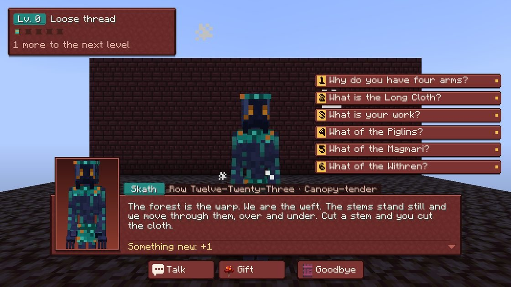<br><sub>A Canopy-tender, Row Twelve-Twenty-Three, on why you never cut a stem.</sub></td>
    <td width="50%">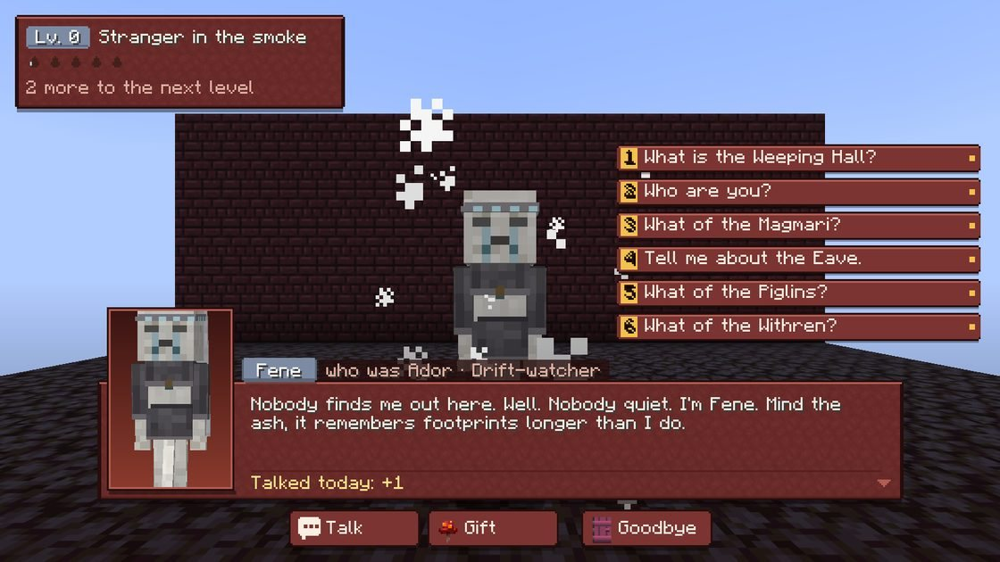<br><sub>Fene, a Drift-watcher: you crept up quietly, so she stayed to talk.</sub></td>
  </tr>
</table>

- **About 13,400 lines**, some 2,600 to 2,750 per people: greetings for every job, level and age, small talk,
  about fifty topics each, gifts, level-ups, farewells and refusals.
- **Friendship** in six levels, earned through talk and gifts. A loved gift can lift someone a whole level, and
  they may give you something back.
- **Stories:** every grown resident has one (64 in all). Hear it, bring what they need, come back another day for the
  rest, then answer them, and the way you answer ends it.
- **The Journal** keeps your memories together, what you know about them, and their story so far.

<table>
  <tr>
    <td width="33%">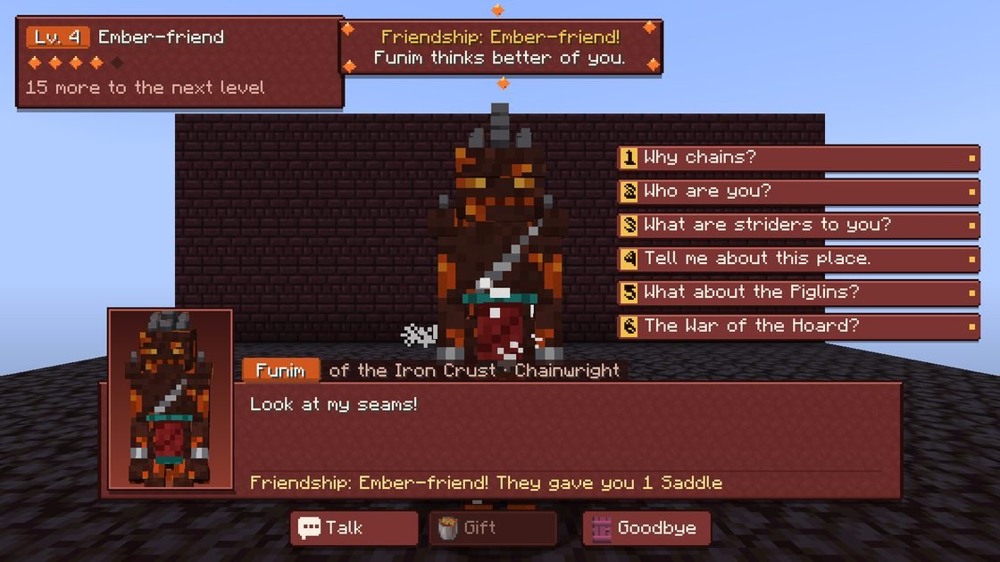<br><sub>A bucket of lava lifts a Magmari to Ember-friend.</sub></td>
    <td width="33%">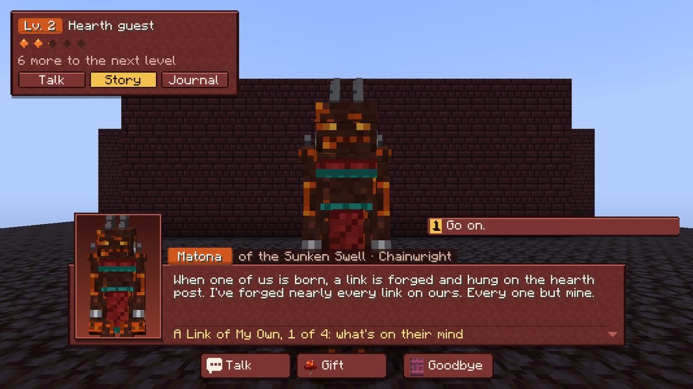<br><sub>Matona's story: every birth link hangs on the hearth post, except hers.</sub></td>
    <td width="33%">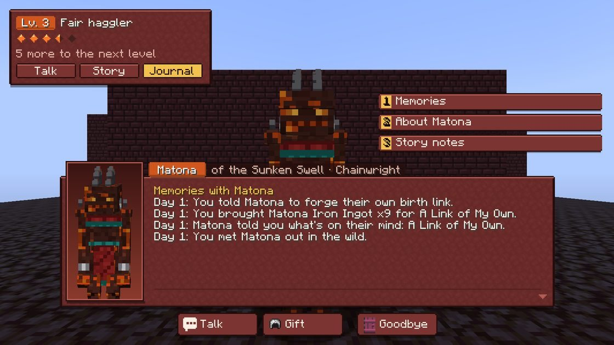<br><sub>The Journal: memories, newest first.</sub></td>
  </tr>
</table>

## They move like themselves

Every people has its own animation pack of 69 to 85 clips (371 in all), the Piglins too, on their unchanged vanilla
model. They idle in character and practise their trade, chat with a neighbour, greet you, gesture while they speak,
listen while you choose a reply, and react to gifts, friendship, your answers and blows.

## Creatures

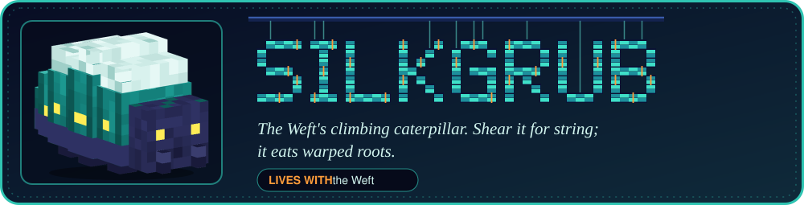

## The lava ferry

<table>
  <tr>
    <td width="50%">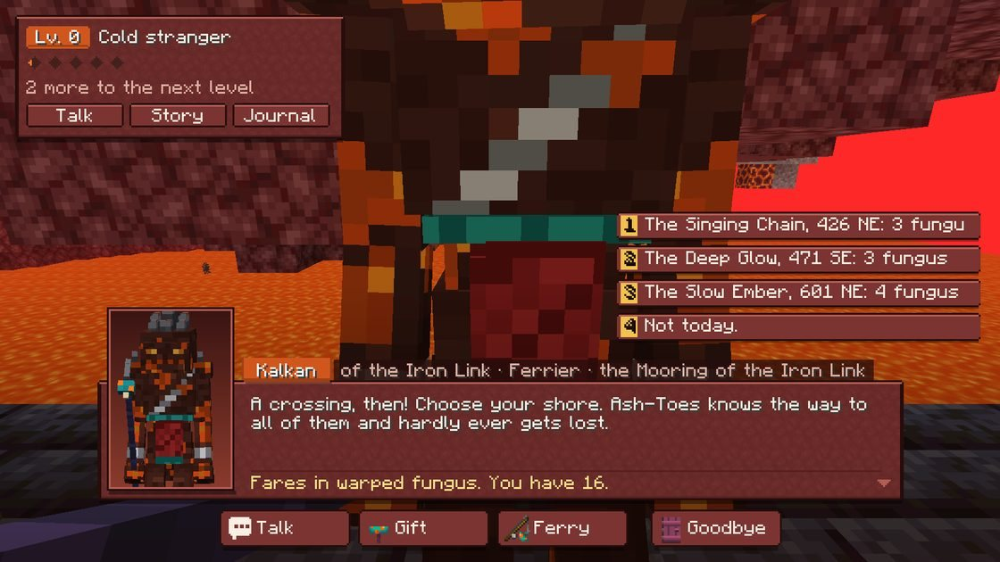</td>
    <td width="50%"></td>
  </tr>
</table>

Ask a Mooring's Ferrier and they offer every other Mooring within a strider's walk, with the fare in warped fungus
(free once you're close friends). The strider tows the barge out, the Ferrier wades alongside for a while and then
turns for home, and you're set down on the far pier.

---

## Getting it

```
gradlew build
```

The jar lands in `build/libs`. It needs Minecraft 26.3, Fabric Loader 0.19.5+ and Fabric API. It's part of the same
modpack as [Village Friends](https://github.com/radhepa/Village-Friends-Minecraft-Mod),
[End Friends](https://github.com/radhepa/EndFriends) and [Sky Friends](https://github.com/radhepa/Sky-Friends), and
works with or without them.

## Testing

```
gradlew test
gradlew runClientGameTest -PtestHeap=3g
```

The client test makes a new world, lines up every people, holds a conversation with each of them through the real
window, tries each creature's use (relighting, shearing, calming a ghast), then finds each kind of village by natural
generation in the Nether, checks every resident has a name and a job and every village keeps its creature, and
photographs it (`build/run/clientGameTest/screenshots`). The Animations part has a row of each people act out every
clip of its pack, photographed mid-motion. `-PnetherTests=Talk` (or `Peoples`, `Creatures`, `Villages`,
`Animations`, `Loot`, `Lava`) runs one part.

## For developers

| Doc | What's in it |
|---|---|
| [PEOPLE.md](docs/PEOPLE.md) | Who the peoples are, their lore and the decisions behind them. |
| [VILLAGES.md](docs/VILLAGES.md) | Every village and building, and how the villages are generated. |
| [DIALOGUE.md](docs/DIALOGUE.md) | Conversations, friendship and the dialogue files (`python tools/check_talk.py` checks them). |
| [STORIES.md](docs/STORIES.md) | The Story and Journal tabs and the story files (`python tools/check_stories.py`). |
| [ANIMATIONS.md](docs/ANIMATIONS.md) | The animation packs, how clips are picked, and how to author them (`python tools/animations/compile.py --check`, `python tools/animations/sheet.py`). |
| [FERRY.md](docs/FERRY.md) | The Magmari lava ferry. |
| [CONVERSATION_UI.md](docs/CONVERSATION_UI.md) | The conversation window, from Village Friends, recoloured netherrack. |

The peoples and creatures are box models drawn by Python scripts (`tools/people/*.py`, `tools/creatures/*.py`,
using `tools/mobkit.py`), which write the model JSON and textures. The Withren's head is the Wither's own: the game
draws it from its own texture at runtime, so no vanilla art is copied into this mod. `python tools/gen_data.py`
writes the world-generation data, loot, tags and spawn eggs.

## License

[MIT](LICENSE). The README art in `docs/readme/` is drawn from the mod's own models and in-game screenshots.
